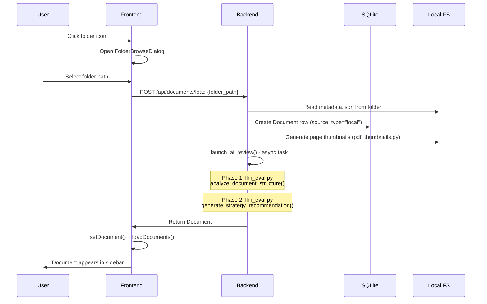
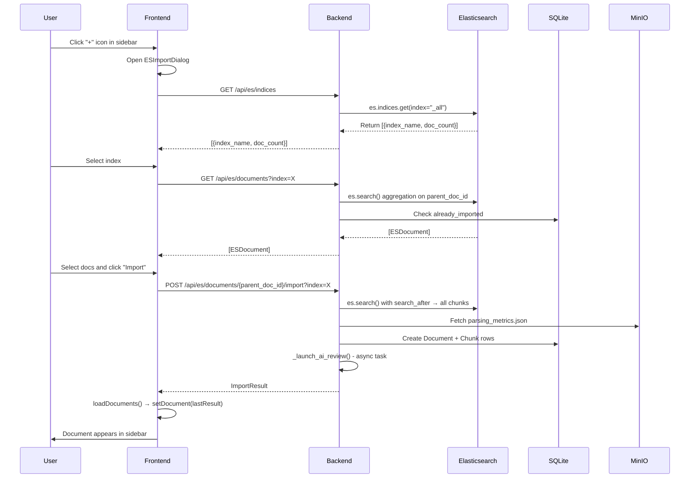
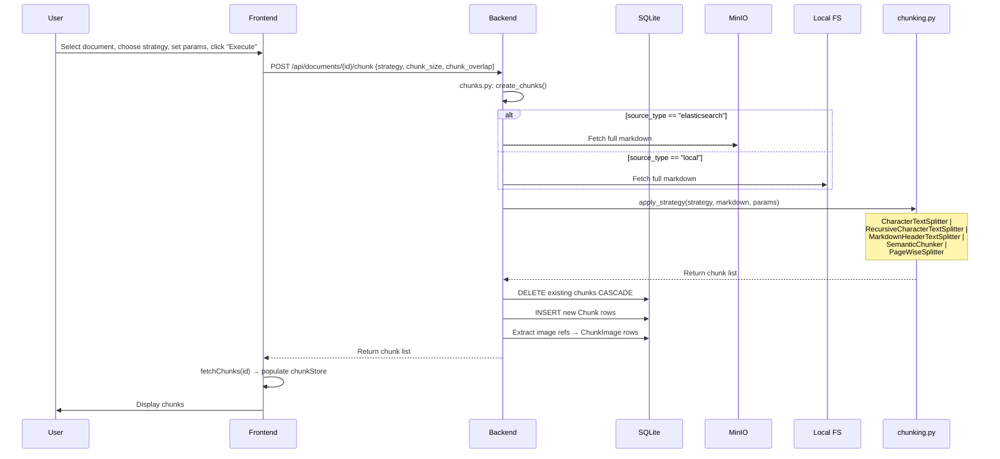
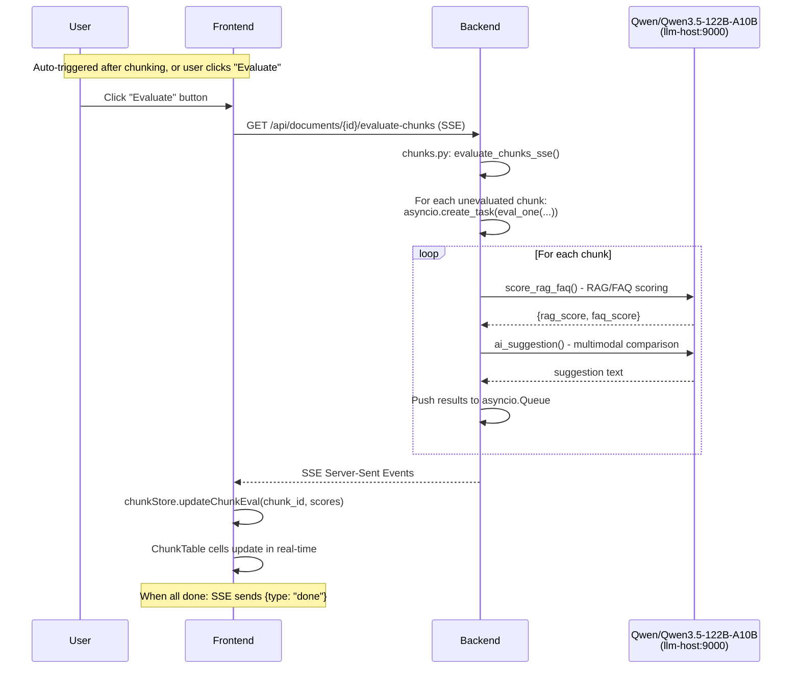
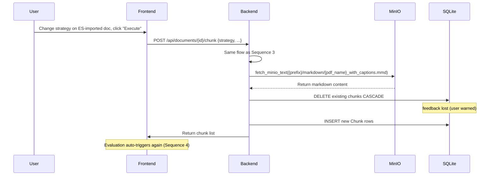
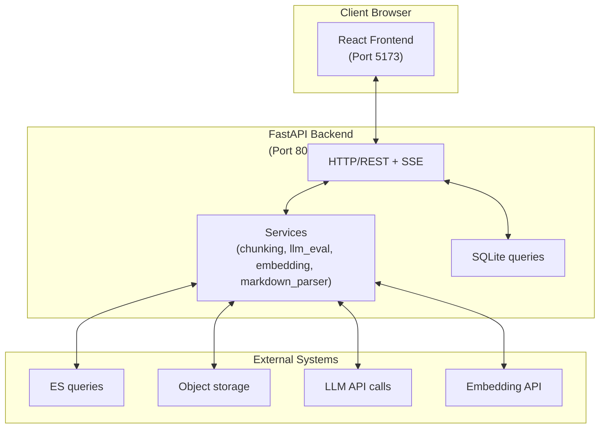
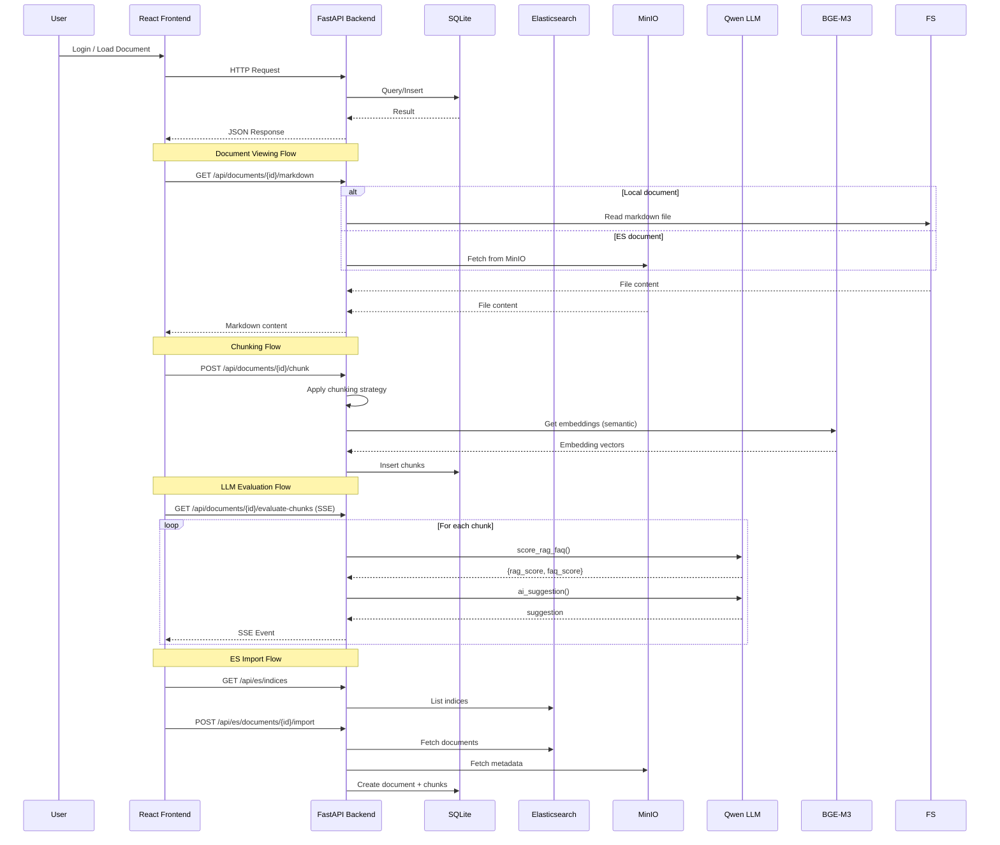
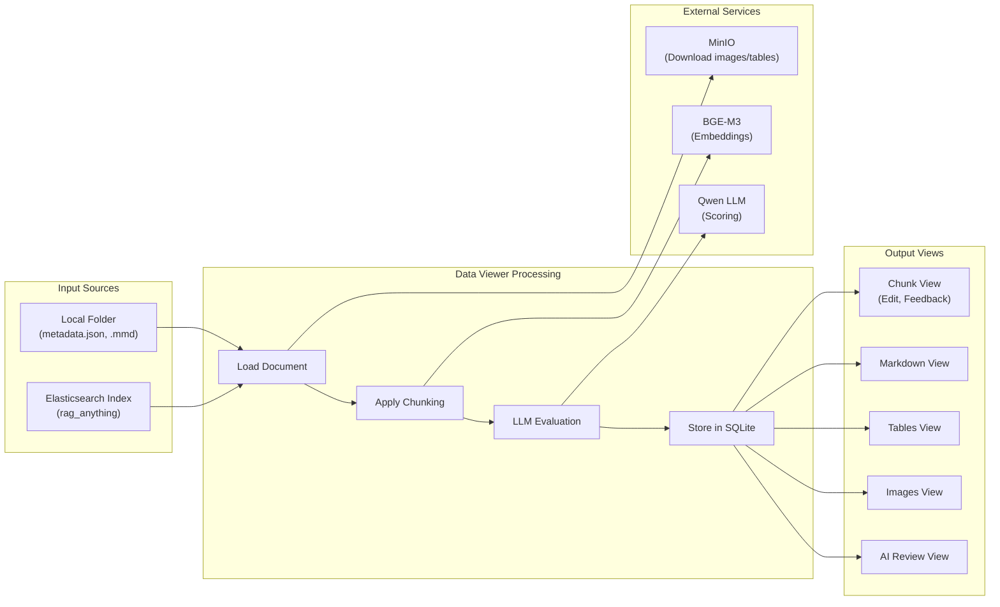

# Data Viewer - Design Specification

## Module List

The Data Viewer application is organized into two primary layers: **backend** (Python/FastAPI) and **frontend** (React/TypeScript), with a test suite covering both.

### Backend modules

| Module | Path | Responsibility |
|--------|------|----------------|
| Application entry | `backend/main.py` | FastAPI app init, lifespan (DB init + user seeding), CORS, static asset serving, SPA catch-all route |
| Configuration | `backend/config.py` | Pydantic Settings from environment variables |
| Database | `backend/db.py` | SQLAlchemy engine, WAL mode, auto-migration, `get_db()` dependency |
| ORM models | `backend/models.py` | 6 SQLAlchemy models: User, Document, Chunk, ChunkEdit, ChunkFeedback, ChunkImage |
| Authentication | `backend/auth.py` | JWT decode/verify, `get_current_user` dependency, token query-param support |
| User seeding | `backend/seed.py` | Creates default users (admin, reviewer1, reviewer2) on startup |
| Auth routes | `backend/api/auth.py` | Login (POST /api/auth/login), me (GET /api/auth/me) |
| Document routes | `backend/api/documents.py` | Load, list, get, delete documents; AI review triggers |
| ES document routes | `backend/api/es_documents.py` | List ES indices, list ES docs, import from ES, refresh from ES |
| File routes | `backend/api/files.py` | Serve markdown, images, tables, layout PDFs, page thumbnails, page markdown |
| View routes | `backend/api/views.py` | text-only, tables-only, images-only content extraction |
| Chunk routes | `backend/api/chunks.py` | Create/list/edit/delete chunks, SSE evaluation streaming, chunk status SSE |
| Feedback routes | `backend/api/feedback.py` | Get/update chunk feedback (emoji + comment) |
| Filesystem routes | `backend/api/filesystem.py` | Browse server directories for document loading |
| Chunking service | `backend/services/chunking.py` | 5 chunking strategies using langchain-text-splitters |
| LLM evaluation service | `backend/services/llm_eval.py` | RAG/FAQ scoring, AI suggestion (multimodal), AI strategy review (2-phase) |
| Embedding service | `backend/services/embedding.py` | BGE-M3 embedding API client |
| Markdown parser | `backend/services/markdown_parser.py` | Extract text, tables, images, table→HTML mapping from .mmd |
| PDF thumbnail service | `backend/services/pdf_thumbnails.py` | Generate JPEG thumbnails from layout PDFs using PyMuPDF |
| Elasticsearch client | `backend/services/es_client.py` | Cached ES client singleton |
| MinIO client | `backend/services/minio_client.py` | Cached MinIO client, fetch bytes/text, list objects |

### Frontend modules

| Module | Path | Responsibility |
|--------|------|----------------|
| App root | `frontend/src/App.tsx` | Router, layout, 5 view modes, auth guard, SSE subscription for auto-evaluation |
| Auth store | `frontend/src/stores/authStore.ts` | Zustand: user, token, login/logout |
| Document store | `frontend/src/stores/documentStore.ts` | Zustand: documents[], selectedDocument, viewMode, loadDocuments |
| Chunk store | `frontend/src/stores/chunkStore.ts` | Zustand: chunks[], selectedChunk, pagination, isChunking, updateChunkEval |
| API client | `frontend/src/api/client.ts` | Axios instance, Bearer token injection, `withToken()` helper |
| Auth API | `frontend/src/api/auth.ts` | Login, getCurrentUser |
| Documents API | `frontend/src/api/documents.ts` | All document + ES document CRUD operations |
| Chunks API | `frontend/src/api/chunks.ts` | Chunk operations, SSE subscriptions |
| Feedback API | `frontend/src/api/feedback.ts` | Get/update feedback |
| Sidebar | `frontend/src/components/Sidebar.tsx` | Document list, view mode switcher, ES import trigger |
| ES Import Dialog | `frontend/src/components/ESImportDialog.tsx` | Index dropdown, doc list, multi-select import |
| Chunk Table | `frontend/src/components/ChunkTable.tsx` | Chunk list with scores, strategy selector, chunk button, feedback |
| Viewer Editor | `frontend/src/components/ViewerEditor.tsx` | Markdown/HTML editing pane with diff view |
| Markdown View | `frontend/src/components/MarkdownView.tsx` | Rendered markdown with layout thumbnails, page-synced scrolling |
| Image Modal | `frontend/src/components/ImageModal.tsx` | Full-screen image viewer with navigation and HTML table rendering |
| Thumbnail Panel | `frontend/src/components/ThumbnailPanel.tsx` | Page thumbnail grid with click-to-scroll |
| Tables Only View | `frontend/src/components/TablesOnlyView.tsx` | Table image gallery with extracted content overlay |
| Images Only View | `frontend/src/components/ImagesOnlyView.tsx` | Categorized image gallery |
| Text Only View | `frontend/src/components/TextOnlyView.tsx` | Text-only paragraphs grouped by page |
| AI Review View | `frontend/src/components/AIReviewView.tsx` | AI strategy recommendation display |
| Diff View | `frontend/src/components/DiffView.tsx` | Side-by-side diff display for chunk edits |
| Feedback Picker | `frontend/src/components/FeedbackPicker.tsx` | Emoji feedback selector (😍 💩 😐) |
| Folder Load Dialog | `frontend/src/components/FolderLoadDialog.tsx` | Server directory browser for document loading |
| Header | `frontend/src/components/Header.tsx` | Top bar with app title and current user info |
| Footer | `frontend/src/components/Footer.tsx` | Bottom bar with settings icon |
| Login Page | `frontend/src/components/LoginPage.tsx` | Login form with username/password |
| PDF Viewer | `frontend/src/components/PdfViewer.tsx` | Embedded PDF viewer for layout PDFs |
| Settings Panel | `frontend/src/components/SettingsPanel.tsx` | Settings modal (delete all docs, logout) |

---

## Module Location and Relation

### Backend dependency graph

```
main.py (entry)
  ├── config.py (settings)
  ├── db.py (engine + get_db)
  ├── seed.py
  └── [8 API routers]
        ├── auth.py
        │     └── auth.py (JWT utilities)
        ├── documents.py
        │     ├── db.py
        │     ├── models.py
        │     ├── auth.py
        │     └── services/
        │           ├── pdf_thumbnails.py
        │           ├── chunking.py
        │           └── llm_eval.py
        ├── es_documents.py
        │     ├── db.py
        │     ├── models.py
        │     ├── auth.py
        │     ├── services/es_client.py
        │     └── services/minio_client.py
        ├── files.py
        │     ├── db.py
        │     ├── models.py
        │     ├── auth.py
        │     ├── services/minio_client.py
        │     └── services/pdf_thumbnails.py
        ├── views.py
        │     ├── db.py
        │     ├── models.py
        │     ├── auth.py
        │     ├── services/markdown_parser.py
        │     └── services/minio_client.py
        ├── chunks.py
        │     ├── db.py
        │     ├── models.py
        │     ├── auth.py
        │     ├── services/chunking.py
        │     ├── services/llm_eval.py
        │     ├── services/embedding.py
        │     ├── services/minio_client.py
        │     └── services/markdown_parser.py
        ├── feedback.py
        │     ├── db.py
        │     ├── models.py
        │     └── auth.py
        └── filesystem.py
              ├── auth.py
              └── db.py
```

### Frontend dependency graph

```
App.tsx
  ├── stores/
  │     ├── authStore.ts
  │     ├── documentStore.ts
  │     └── chunkStore.ts
  ├── api/
  │     ├── client.ts (Axios instance)
  │     ├── auth.ts
  │     ├── documents.ts
  │     ├── chunks.ts
  │     └── feedback.ts
  └── components/
        ├── Sidebar.tsx
        │     ├── stores/documentStore.ts
        │     └── api/documents.ts
        ├── ESImportDialog.tsx
        │     ├── stores/documentStore.ts
        │     └── api/documents.ts
        ├── ChunkTable.tsx
        │     ├── stores/documentStore.ts
        │     ├── stores/chunkStore.ts
        │     ├── api/documents.ts
        │     └── api/chunks.ts
        ├── ViewerEditor.tsx
        │     ├── stores/chunkStore.ts
        │     └── api/chunks.ts
        ├── MarkdownView.tsx
        │     ├── api/client.ts (withToken)
        │     └── stores/chunkStore.ts
        ├── ImageModal.tsx
        │     ├── api/client.ts (withToken)
        │     └── services/markdown_parser.ts (extract_table_html_map)
        ├── ThumbnailPanel.tsx
        │     └── api/client.ts (withToken)
        ├── TablesOnlyView.tsx
        ├── ImagesOnlyView.tsx
        └── AIReviewView.tsx
```

### Data layer relations

```
SQLite (WAL mode)
  ├── users
  ├── documents  ──────────────────────────[1:N]──▶ chunks
  │     │                                                  │
  │     ├── source_type: "local" | "elasticsearch"         │
  │     ├── es_index, es_parent_doc_id, minio_prefix       │
  │     ├── folder_path (local)                            │
  │     └── chunking_strategy                              │
  │                                                 [1:N]──┼──▶ chunk_edits
  │                                                 [1:N]──┼──▶ chunk_feedback
  │                                                 [1:N]──┼──▶ chunk_images
  └── (no direct table for ES/MinIO — external systems)

External systems (read-only from Data Viewer's perspective):
  ├── Elasticsearch ──[es_documents.py]──▶ Document + Chunk rows
  └── MinIO ──────────[files.py]──────────▶ images, tables, markdown, thumbnails
```

---

## Main Sequence of Process

### Sequence 1: Load document from local folder



### Sequence 2: Import document from Elasticsearch



### Sequence 3: Chunk document with strategy



### Sequence 4: LLM evaluation (RAG/FAQ scoring)



### Sequence 5: Re-chunk ES document (from MinIO markdown)



---

## System Architecture Diagram

### High-Level System Architecture



### Component Interaction Overview



### Data Flow Diagram



---

## Function List

### Backend API functions

#### Auth (`backend/api/auth.py`)

| Function | Method | Path | Description |
|----------|--------|------|-------------|
| `login` | POST | `/api/auth/login` | Validate credentials, return JWT + user info |
| `get_me` | GET | `/api/auth/me` | Return current authenticated user |

#### Documents (`backend/api/documents.py`)

| Function | Method | Path | Description |
|----------|--------|------|-------------|
| `load_document` | POST | `/api/documents/load` | Load from local folder: parse metadata, create DB record, generate thumbnails, launch AI review |
| `list_documents` | GET | `/api/documents` | Return all documents (paginated, searchable) |
| `get_document` | GET | `/api/documents/{id}` | Return document with full metadata + parsing metrics |
| `delete_document` | DELETE | `/api/documents/{id}` | Delete document + cascade to chunks/edits/feedback |
| `get_ai_review` | GET | `/api/documents/{id}/ai-review` | Return AI strategy recommendation (Phase 2 output) |
| `retry_ai_review` | POST | `/api/documents/{id}/ai-review/retry` | Re-run both phases of AI review |

#### ES Documents (`backend/api/es_documents.py`)

| Function | Method | Path | Description |
|----------|--------|------|-------------|
| `list_indices` | GET | `/api/es/indices` | List all non-hidden ES indices with doc counts |
| `list_es_documents` | GET | `/api/es/documents` | List unique parent_doc_ids in an index (aggregated), mark already-imported |
| `import_document` | POST | `/api/es/documents/{parent_doc_id}/import` | Import document chunks from ES into SQLite |
| `refresh_document` | POST | `/api/es/documents/{document_id}/refresh` | Re-import chunks from ES (replace existing) |

#### Files (`backend/api/files.py`)

| Function | Method | Path | Description |
|----------|--------|------|-------------|
| `get_markdown` | GET | `/api/documents/{id}/markdown` | Full markdown (from local FS or MinIO based on source_type) |
| `get_image` | GET | `/api/documents/{id}/images/{name}` | Document image (tries direct + prefixed MinIO path) |
| `get_table_image` | GET | `/api/documents/{id}/tables/{name}` | Table image (from local FS or MinIO) |
| `get_layout_pdf` | GET | `/api/documents/{id}/layout-pdf` | Layout analysis PDF (local FS or MinIO) |
| `get_page_markdown` | GET | `/api/documents/{id}/page/{n}/markdown` | Single page markdown (split by `---` delimiters) |
| `get_page_thumbnail` | GET | `/api/documents/{id}/page/{n}/thumbnail` | Page thumbnail: tries pages/ first, then layout_pages/, then on-demand PDF render |
| `get_layout_thumbnail` | GET | `/api/documents/{id}/layout-thumbnail/{n}` | Layout PDF thumbnail: tries layout_pages/ first, then pages/ fallback |

#### Views (`backend/api/views.py`)

| Function | Method | Path | Description |
|----------|--------|------|-------------|
| `get_text_only` | GET | `/api/documents/{id}/text-only` | Non-empty text paragraphs grouped by page |
| `get_tables_only` | GET | `/api/documents/{id}/tables-only` | Table images + markdown tables + HTML table map |
| `get_images_only` | GET | `/api/documents/{id}/images-only` | Images with captions and category tags |

#### Chunks (`backend/api/chunks.py`)

| Function | Method | Path | Description |
|----------|--------|------|-------------|
| `create_chunks` | POST | `/api/documents/{id}/chunk` | Apply chunking strategy, delete old chunks, insert new |
| `list_chunks` | GET | `/api/documents/{id}/chunks` | Paginated chunk list with search filter |
| `get_chunk` | GET | `/api/documents/{id}/chunks/{cid}` | Single chunk detail |
| `update_chunk_edit` | PUT | `/api/chunks/{cid}/edit` | Save edited chunk content (stores original separately) |
| `get_chunk_diff` | GET | `/api/chunks/{cid}/diff` | Return original vs modified content for diff display |
| `delete_chunk_edit` | DELETE | `/api/chunks/{cid}/edit` | Revert chunk to original text |
| `delete_all_chunks` | DELETE | `/api/documents/{id}/chunks` | Delete all chunks for a document |
| `chunk_status_sse` | GET | `/api/documents/{id}/chunk-status` | SSE for async chunking progress (semantic strategy) |
| `evaluate_chunks_sse` | GET | `/api/documents/{id}/evaluate-chunks` | SSE: parallel LLM evaluation with streaming results |

#### Feedback (`backend/api/feedback.py`)

| Function | Method | Path | Description |
|----------|--------|------|-------------|
| `get_feedback` | GET | `/api/chunks/{cid}/feedback` | Get current user's feedback for a chunk |
| `update_feedback` | PUT | `/api/chunks/{cid}/feedback` | Upsert emoji and/or comment (independent fields) |

#### Filesystem (`backend/api/filesystem.py`)

| Function | Method | Path | Description |
|----------|--------|------|-------------|
| `browse` | POST | `/api/filesystem/browse` | List directory contents at a given path |

### Backend service functions

| Module | Function | Description |
|--------|----------|-------------|
| `chunking.py` | `apply_chunking_strategy(doc_id, strategy, chunk_size, overlap)` | Entry point; fetches markdown and delegates |
| `chunking.py` | `split_by_character(text, size, overlap)` | langchain CharacterTextSplitter wrapper |
| `chunking.py` | `split_recursive(text, size, overlap)` | langchain RecursiveCharacterTextSplitter wrapper |
| `chunking.py` | `split_markdown(text)` | langchain MarkdownHeaderTextSplitter wrapper |
| `chunking.py` | `split_semantic(text, doc_id, size, overlap, threshold)` | BGE-M3 embedding + clustering |
| `chunking.py` | `split_page_wise(text)` | Split on `---` page delimiters |
| `llm_eval.py` | `analyze_document_structure(markdown, doc_id)` | Phase 1: full doc analysis → measured section data |
| `llm_eval.py` | `generate_strategy_recommendation(doc_id)` | Phase 2: strategy recommendation from Phase 1 results |
| `llm_eval.py` | `score_rag_faq(chunk_text, page_num, doc_id)` | RAG/FAQ 0-10 scoring with 5 criteria each |
| `llm_eval.py` | `ai_suggestion(chunk_text, page_thumbnail_base64, page_num)` | Multimodal comparison: text vs screenshot |
| `embedding.py` | `get_embeddings(texts)` | BGE-M3 batch embedding via HTTP |
| `markdown_parser.py` | `extract_text_only(markdown)` | Strip images/italics, group into paragraphs |
| `markdown_parser.py` | `extract_tables(markdown)` | Extract markdown tables with description context |
| `markdown_parser.py` | `extract_images_with_captions(markdown)` | Image refs + italic captions + blockquote descriptions |
| `markdown_parser.py` | `extract_table_html_map(markdown)` | Map `` to HTML/markdown table content |
| `pdf_thumbnails.py` | `generate_thumbnail(pdf_path, page_num, output_path)` | Render one PDF page to JPEG at 150 DPI |
| `pdf_thumbnails.py` | `get_thumbnail_path(doc_id, page_num)` | Return Path to thumbnail file (generate if missing) |
| `es_client.py` | `get_es_client()` | Cached Elasticsearch singleton |
| `minio_client.py` | `get_minio_client()` | Cached MinIO client singleton |
| `minio_client.py` | `fetch_minio_bytes(object_name)` | Download object as bytes |
| `minio_client.py` | `fetch_minio_text(object_name)` | Download object as UTF-8 string |
| `minio_client.py` | `list_minio_objects(prefix)` | List objects under prefix |
| `minio_client.py` | `minio_object_exists(object_name)` | Check if object exists |

### Frontend functions

| Component | Function | Description |
|-----------|----------|-------------|
| `App.tsx` | `App` | Root: auth check, layout, view mode routing, SSE auto-evaluation |
| `App.tsx` | `subscribeEvaluation(docId, cb)` | Open SSE connection for evaluation streaming |
| `Sidebar.tsx` | `Sidebar` | Document list, view mode tabs, ES import button |
| `ESImportDialog.tsx` | `ESImportDialog` | Index selector + document list + import with progress |
| `ChunkTable.tsx` | `ChunkTable` | Chunk list with search, sort, scores, strategy selector |
| `ChunkTable.tsx` | `handleChunk` | Call POST /chunk, then refetch chunks |
| `ChunkTable.tsx` | `handleEvaluate` | Open SSE connection, update scores on events |
| `ViewerEditor.tsx` | `ViewerEditor` | Markdown/HTML editor with save/cancel/diff |
| `MarkdownView.tsx` | `MarkdownView` | Rendered markdown + synced thumbnail pane |
| `ImageModal.tsx` | `ImageModal` | Fullscreen image + HTML table rendering + navigation |
| `ThumbnailPanel.tsx` | `ThumbnailPanel` | Grid of page thumbnails, click to scroll markdown |
| `TablesOnlyView.tsx` | `TablesOnlyView` | Table image gallery with click-to-modal |
| `ImagesOnlyView.tsx` | `ImagesOnlyView` | Image gallery with captions and categories |
| `AIReviewView.tsx` | `AIReviewView` | Display AI strategy recommendation and section analysis |
| `stores/authStore.ts` | `login(username, password)` | Call API, store token in localStorage |
| `stores/authStore.ts` | `logout()` | Clear store + localStorage |
| `stores/documentStore.ts` | `loadDocuments()` | Fetch all documents from API |
| `stores/documentStore.ts` | `setDocument(doc)` | Set selected document |
| `stores/chunkStore.ts` | `fetchChunks(docId)` | Fetch chunks for document |
| `stores/chunkStore.ts` | `updateChunkEval(cid, data)` | Update a chunk's evaluation scores in place |
| `api/client.ts` | `client` | Axios instance with auth interceptor |
| `api/client.ts` | `withToken(path)` | Append ?token=JWT to path for img/src and EventSource |

---

## UI List

### Layout structure

The application uses a fixed layout with a collapsible sidebar and a main content area:

```
┌──────────────────────────────────────────────────────┐
│  Header bar (app name + current user + logout)       │
├──────────────┬───────────────────────────────────────┤
│              │                                       │
│   Sidebar    │         Main Content Area             │
│  (250px)     │         (remaining width)             │
│              │                                       │
│  - Doc list  │   [View mode renders here]            │
│  - View tabs │                                       │
│  - + Import  │                                       │
│              │                                       │
└──────────────┴───────────────────────────────────────┘
```

### View modes (5 total)

| View Mode | Japanese Name | Component | Description |
|-----------|--------------|-----------|-------------|
| Chunks | チャンク | ThumbnailPanel + ChunkTable + ViewerEditor | Split: thumbnails (left) + table (center) + editor (right) |
| Markdown | Markdown | MarkdownView | Rendered .mmd with page-synced layout thumbnail pane |
| Tables | テーブル | TablesOnlyView | Grid of table images; click for modal with extracted HTML |
| Images | 画像 | ImagesOnlyView | Grid of document images with captions |
| AI Review | AIレビュー | AIReviewView | Phase 1 section analysis + Phase 2 strategy recommendation |

### Chunk view (3-pane layout)

```
┌─────────────────┬─────────────────────────────┬──────────────────────┐
│  ThumbnailPanel │       ChunkTable            │    ViewerEditor      │
│  (page thumbs)  │  [strategy][size][overlap]  │  (content editing)   │
│                 │  [search]                   │                      │
│  Click thumb to │  chunks list:               │  [Edit] [Cancel]     │
│  scroll to page │  - page, index, text preview│  [Original] [Diff]   │
│                 │  - rag★ faq★ suggestion     │                      │
│                 │  - emoji 😍 💩 😐           │                      │
│                 │                             │                      │
│  Draggable ─────┼─────────────────────────────│                      │
│  divider        │                             │                      │
└─────────────────┴─────────────────────────────┴──────────────────────┘
```

### Dialogs and overlays

| Dialog | Trigger | Purpose |
|--------|---------|---------|
| Login dialog | Initial load when unauthenticated | Username/password form |
| ES Import dialog | Click "+" in sidebar | Index selector + document list + import |
| Image modal | Click any image (thumbnails, table images, page images) | Full-screen with prev/next + HTML table rendering |
| AI suggestion overlay | Click suggestion cell in ChunkTable | Shows text vs screenshot comparison result |

### LibreChat integration (future UI)

The design specification includes a planned **LibreChat** integration for conversational querying of document chunks. This component is not yet implemented in the current frontend but is documented here as the target user interface for the Qwen-powered chat.

#### LibreChat UI for Data Viewer

LibreChat (https://github.com/danny-avila/LibreChat) is an open-source ChatGPT clone that supports custom LLM endpoints and MCP server integration. In the Data Viewer context, it would be deployed as a separate service that:

1. **Connects to Qwen/Qwen3.5-122B-A10B** at `llm-host:9000/v1` as a custom OpenAI-compatible endpoint
2. **Serves as the conversational UI** for users to ask questions about the currently selected document's chunks
3. **Integrates via MCP server** for displaying chunk metadata images in the chat

#### MCP server for chunk metadata images

A custom MCP (Model Context Protocol) server would be built to:

1. **Receive queries** from LibreChat about specific chunks (chunk ID or page number)
2. **Fetch chunk data** from the Data Viewer SQLite database
3. **Return structured context** including:
   - Chunk text content
   - Page number and position within document
   - RAG/FAQ evaluation scores
   - Image references from `chunk_images` table
   - The actual images (as base64 or URL) for display in chat
4. **Enable multimodal responses** — Qwen can see the page screenshot and chunk text simultaneously when generating answers

```
┌──────────────────┐      ┌─────────────────┐      ┌──────────────────┐
│    LibreChat     │─────▶│  Data Viewer    │─────▶│   Qwen LLM       │
│  (user chat UI)  │      │  MCP Server     │      │  llm-host:9000   │
│                  │◀─────│                 │◀─────│                  │
│  [page screenshot│      │  [fetches chunk │      │  [text + image   │
│   shown in chat] │      │   + images]     │      │   answer]        │
└──────────────────┘      └─────────────────┘      └──────────────────┘
```

#### MCP server endpoints (proposed)

| Tool | Input | Output |
|------|-------|--------|
| `get_chunk` | `chunk_id: number` | `{id, text, page, rag_score, faq_score, images: [{path, caption}]}` |
| `get_page_chunks` | `doc_id: number, page: number` | `Chunk[]` for that page |
| `get_page_image` | `doc_id: number, page: number` | `base64 PNG of page thumbnail` |
| `get_document_summary` | `doc_id: number` | `{title, pages, num_chunks, strategies_used}` |

#### LibreChat configuration (proposed)

```yaml
# librechat.yaml
endpoints:
  custom:
    Qwen:
      name: Qwen3.5-122B-A10B
      apiKey: "dummy"  # not used with local endpoint
      baseURL: http://llm-host:9000/v1
      models:
        default: qwen3.5-122b-a10b
      TitleModel: qwen3.5-122b-a10b
```

#### Image display in chat (proposed)

The MCP server returns image references; LibreChat renders them inline using standard markdown image syntax:

```
User: 3ページ目のChunksについて教えて
Bot: 3ページ目には12個のChunkがあります主要的...]
   [page_3_screenshot.png]
   Chunk 7: RAG★★ / FAQ★★
   [table_image_3_1.jpg]
```

### Component inventory

| Component | Type | File | Key States |
|-----------|------|------|-----------|
| Sidebar | Layout | `Sidebar.tsx` | collapsed, expanded |
| ESImportDialog | Modal | `ESImportDialog.tsx` | loading indices, index selected, docs loaded, importing |
| ChunkTable | Table | `ChunkTable.tsx` | loading, empty, populated, chunking in progress, evaluating |
| ViewerEditor | Editor | `ViewerEditor.tsx` | view mode, edit mode, diff mode |
| MarkdownView | Viewer | `MarkdownView.tsx` | loading, rendered, scroll-synced |
| ThumbnailPanel | Grid | `ThumbnailPanel.tsx` | loading, populated, selected page |
| ImageModal | Modal | `ImageModal.tsx` | closed, open (single), navigating |
| TablesOnlyView | Grid | `TablesOnlyView.tsx` | loading, empty, populated |
| ImagesOnlyView | Grid | `ImagesOnlyView.tsx` | loading, empty, populated |
| AIReviewView | Viewer | `AIReviewView.tsx` | no review, phase 1 running, phase 2 running, complete |
| LoginDialog | Modal | `App.tsx` | idle, submitting, error |

### Color and theme

The application uses CSS custom properties defined in `frontend/src/styles/globals.css`:

| Token | Default | Usage |
|-------|---------|-------|
| `--color-primary` | `#3b82f6` | Buttons, badges, selected states |
| `--color-bg` | `#f9fafb` | Page background |
| `--color-surface` | `#ffffff` | Cards, dialogs |
| `--color-border` | `#e5e7eb` | Borders, dividers |
| `--color-text` | `#111827` | Primary text |
| `--color-text-muted` | `#6b7280` | Secondary text, labels |
| `--color-success` | `#16a34a` | High scores, imported badges |
| `--color-danger` | `#dc2626` | Delete actions, errors |
| `--font-display` | system-ui | Headings, labels |
| `--font-mono` | monospace | Code, metadata, badges |
| `--font-body` | system-ui | Body text |